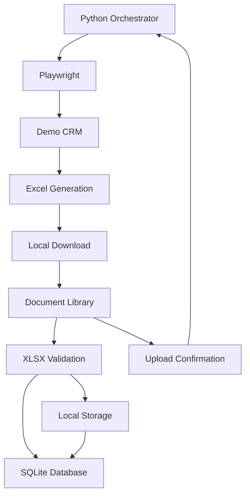

# Project Architecture

**Português:** [Leia a versão em português](architecture.md).

**Learning guide:** [follow the study path](learning-guide.en.md).

## 1. Overview

The `automacao-crm-excel-cloud` project demonstrates a web automation workflow built with Python. It uses Playwright to control a browser and interact with two independent web applications.

This documentation serves two purposes: to record the project's architecture as part of a software development portfolio and to provide learning material for people who want to understand, reproduce, or adapt a similar automation workflow.

The solution contains three main components:

- **Demo CRM:** generates fictional business reports in Excel.
- **Cloud Library:** receives, validates, and stores uploaded documents.
- **Python automation:** controls the browser and carries out the transfer between the applications.

All components run locally and use synthetic data.

## 2. Architecture components

### 2.1 Demo CRM

A web application built with FastAPI.

Responsibilities:

- Display a login page.
- Authenticate users with fictional credentials.
- Provide synthetic business data.
- Display deals in a dashboard.
- Allow queries by date range.
- Generate Excel reports using openpyxl.
- Make reports available for download.
- Display the interface in Portuguese (PT-BR) and English.
- Generate Excel reports with headers, stages, and summary labels in the selected language.

Local address:

`http://127.0.0.1:8000`

### 2.2 Python automation

The component responsible for executing the workflow between the applications.

Responsibilities:

- Launch the Chromium browser using Playwright.
- Configure a browser context with download support.
- Open the demo CRM.
- Authenticate with the CRM.
- Trigger report export.
- Download the Excel file.
- Open the document library.
- Perform a separate authentication.
- Upload the file through the web interface.
- Wait for and verify the upload confirmation.

The main workflow uses the browser interface to perform these operations instead of relying on direct calls to the applications' internal APIs.

The report period uses the default values provided by the CRM in the current implementation.

### 2.3 Document library

An independent web application, also built with FastAPI.

Responsibilities:

- Display a login page in Portuguese and English.
- Allow language switching on the login page and dashboard.
- Receive `.xlsx` files.
- Validate received files.
- Enforce file size and structure limits.
- Store documents in the local file system.
- Generate unique identifiers for stored files.
- Calculate SHA-256 hashes.
- Store metadata in SQLite.
- Manage document versions.
- Display the history of uploaded files.

Local address:

`http://127.0.0.1:8001`

### 2.4 Languages and localization

The CRM and Cloud Library provide interfaces in Portuguese (PT-BR) and English.

The language preference is stored in each application's session and can be changed through the `PT-BR / EN` selector. Since the applications have independent sessions, the language can be selected separately in each system.

Localization changes visible text, validation messages, date and currency formatting, and the contents of the generated Excel report. In PT-BR mode, amounts remain in Brazilian reais (BRL). In English mode, the CRM converts BRL amounts to USD using the latest reference rate retrieved from the Frankfurter API. The rate date and source are displayed in the dashboard and recorded in the Excel summary. Original records remain stored in BRL; conversion happens only in the presentation and export layers.

The `src/crm_cloud_demo/currency.py` module retrieves the BRL/USD pair, validates the response, caches the rate for six hours, and performs calculations with `Decimal`. Frankfurter provides reference rates, not real-time trading quotes. If the request fails and no valid cached rate is available, the English interface reports that conversion is unavailable and an USD report is not generated. Technical field names, routes, forms, and selectors used by Playwright remain stable so the automation is not broken.

## 3. Execution workflow

The automation follows this sequence:

1. The automation launches Chromium.
2. Playwright opens the demo CRM.
3. The automation logs in.
4. Playwright locates and submits the export form.
5. The CRM generates the Excel report.
6. Playwright downloads the file.
7. The file is saved in the local downloads directory.
8. The browser opens the document library.
9. The automation performs the second login.
10. The file is selected in the upload form.
11. The library receives and validates the document.
12. The file is stored in the local file system.
13. SQLite records the metadata and version.
14. The automation waits for the confirmation message.
15. The process finishes.

## 4. Architecture diagram

## 5. Communication between components

The main workflow communicates through the local web interfaces.

| Source | Destination | Purpose |
|---|---|---|
| Playwright | CRM | Authentication and report export |
| CRM | Browser | Make the Excel file available |
| Playwright | Library | Authentication and upload |
| Library | Validation | Verify the received file |
| Library | File system | Store documents |
| Library | SQLite | Record metadata and versions |

The automation uses actual browser interactions to perform login, export, and upload operations.

## 6. Storage and versioning

Storage uses the local file system and an SQLite database.

Uploaded documents:

- Are stored with unique identifiers.
- Keep the original filename in their metadata.
- Receive a SHA-256 hash.
- Have their size and upload date recorded.
- Receive a version number.
- Do not destructively replace files from previous versions.

The SQLite database stores information such as:

- Document identifier.
- Original filename.
- Stored filename.
- SHA-256 hash.
- File size in bytes.
- Version number.
- Upload date and time.

## 7. Error handling

The current implementation includes checks for situations such as:

- Invalid credentials.
- Missing file during upload.
- File extension other than `.xlsx`.
- Empty files or files exceeding the allowed limit.
- Invalid Excel file structure.
- Navigation or download failures.
- Missing upload confirmation.

The workflow uses Python exceptions and Playwright checks to identify failures during execution.

Full integration of the logging system and broader failure handling are part of the planned improvements.

## 8. Security and isolation

The project follows isolation and security principles:

- Fictional and independent applications.
- Synthetic data only.
- Servers bound to the local address `127.0.0.1`.
- Demonstration-only credentials.
- Independent session secrets.
- Separation of source code and configuration.
- Local file protection through `.gitignore`.
- Validation of received files.
- Upload size and content limits.
- Storage with unique identifiers.
- No integration with real corporate systems.

This is an educational project and must not be considered production-ready software.

## 9. Current status and next steps

The main workflow has been implemented and successfully executed in a local environment.

Completed implementation steps include:

1. Python environment setup.
2. Demo CRM implementation.
3. Document library implementation.
4. Chromium and Playwright setup.
5. Automated login to both applications.
6. Automatic Excel report download.
7. Automated upload to the library.
8. Version registration and upload confirmation.

Planned improvements:

- Expand unit tests and add integration tests for the complete workflows.
- Independently validate the report after download.
- Integrate the logging system with the orchestrator.
- Improve failure handling.
- Schedule execution through Windows Task Scheduler.
- Expand documentation and security reviews.

## 10. Final considerations

The architecture was designed to address a practical report-transfer scenario while making the technical decisions behind the solution understandable. It documents how the applications, automation robot, browser, storage layer, and database work together.

The project has two equally important goals: to demonstrate practical skills as part of a software development portfolio and to share knowledge so others can study the architecture, reproduce the workflow, and adapt the solution to similar problems.

The implementation is independent, uses fictional applications and local infrastructure, and was developed in Brazil.
