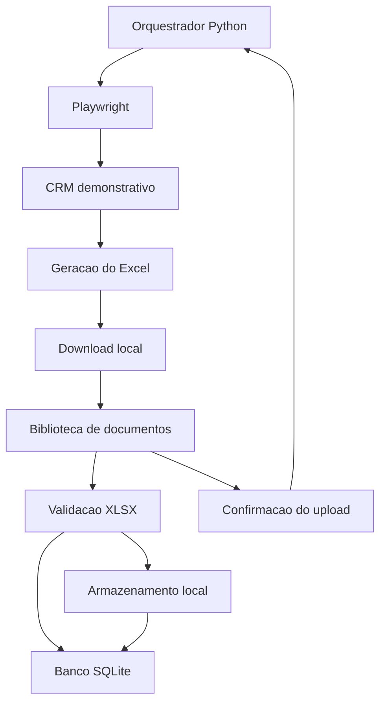

# Arquitetura do Projeto

**English:** [Read the English version](architecture.en.md).

## 1. Visão geral

O projeto `automacao-crm-excel-cloud` demonstra um processo de automação web desenvolvido em Python, utilizando Playwright para controlar um navegador e interagir com duas aplicações web independentes.

A solução contém três componentes principais:

- **CRM demonstrativo:** gera relatórios comerciais fictícios em Excel.
- **Cloud Library:** recebe, valida e armazena os documentos enviados.
- **Automação Python:** controla o navegador e executa o processo de transferência entre as aplicações.

Todos os componentes são executados localmente e utilizam dados sintéticos.

## 2. Componentes da arquitetura

### 2.1 CRM demonstrativo

Aplicação web desenvolvida com FastAPI.

Responsabilidades:

- Apresentar uma tela de autenticação.
- Autenticar usuários com credenciais fictícias.
- Disponibilizar dados comerciais sintéticos.
- Apresentar negociações em um painel.
- Permitir a consulta por período.
- Gerar relatórios em Excel utilizando openpyxl.
- Disponibilizar o download dos relatórios.

Endereço local:

`http://127.0.0.1:8000`

### 2.2 Automação Python

Componente responsável por executar o fluxo entre as aplicações.

Responsabilidades:

- Inicializar o navegador Chromium utilizando Playwright.
- Configurar um contexto com suporte a downloads.
- Acessar o CRM demonstrativo.
- Realizar autenticação.
- Acionar a exportação do relatório.
- Baixar o arquivo Excel.
- Acessar a biblioteca de documentos.
- Realizar autenticação independente.
- Enviar o arquivo por meio da interface web.
- Aguardar e verificar a confirmação do upload.

O fluxo principal utiliza a interface do navegador para realizar as operações, sem depender de chamadas diretas às APIs internas das aplicações.

O período do relatório utiliza os valores padrão apresentados pelo CRM na implementação atual.

### 2.3 Biblioteca de documentos

Aplicação web independente, também desenvolvida com FastAPI.

Responsabilidades:

- Apresentar uma tela de autenticação.
- Receber arquivos no formato `.xlsx`.
- Validar os arquivos recebidos.
- Aplicar limites de tamanho e estrutura.
- Armazenar os documentos no sistema de arquivos local.
- Gerar identificadores únicos para os arquivos armazenados.
- Calcular hashes SHA-256.
- Registrar metadados no SQLite.
- Controlar versões dos documentos.
- Apresentar o histórico de arquivos enviados.

Endereço local:

`http://127.0.0.1:8001`

## 3. Fluxo de execução

O processo de automação segue esta sequência:

1. A automação inicializa o Chromium.
2. O Playwright acessa o CRM demonstrativo.
3. A automação realiza o login.
4. O Playwright localiza e aciona o formulário de exportação.
5. O CRM gera o relatório Excel.
6. O Playwright realiza o download do arquivo.
7. O arquivo é armazenado no diretório local de downloads.
8. O navegador acessa a biblioteca de documentos.
9. A automação realiza o segundo login.
10. O arquivo é selecionado no formulário de upload.
11. A biblioteca recebe e valida o documento.
12. O arquivo é armazenado no sistema de arquivos local.
13. O SQLite registra os metadados e a versão.
14. A automação aguarda a mensagem de confirmação.
15. O processo é finalizado.

## 4. Diagrama da arquitetura

## 5. Comunicação entre componentes

A comunicação do fluxo principal ocorre por meio das interfaces web locais.

| Origem | Destino | Finalidade |
|---|---|---|
| Playwright | CRM | Autenticação e exportação |
| CRM | Navegador | Disponibilização do Excel |
| Playwright | Biblioteca | Autenticação e upload |
| Biblioteca | Validação | Verificação do arquivo recebido |
| Biblioteca | Sistema de arquivos | Armazenamento dos documentos |
| Biblioteca | SQLite | Registro dos metadados e versões |

A automação utiliza interações reais de navegador para executar login, exportação e upload.

## 6. Armazenamento e versionamento

O armazenamento utiliza o sistema de arquivos local e um banco de dados SQLite.

Os documentos enviados:

- São armazenados com identificadores únicos.
- Mantêm o nome original registrado nos metadados.
- Recebem um hash SHA-256.
- Possuem registro de tamanho e data de envio.
- Recebem numeração de versão.
- Não substituem destrutivamente os arquivos de versões anteriores.

O banco SQLite mantém informações como:

- Identificador do documento.
- Nome original do arquivo.
- Nome utilizado no armazenamento.
- Hash SHA-256.
- Tamanho em bytes.
- Número da versão.
- Data e horário do envio.

## 7. Tratamento de erros

A implementação atual possui verificações para situações como:

- Credenciais inválidas.
- Arquivo inexistente para upload.
- Extensão diferente de `.xlsx`.
- Arquivo vazio ou acima do limite permitido.
- Estrutura inválida de arquivo Excel.
- Falhas durante a navegação ou download.
- Ausência de confirmação do upload.

O fluxo utiliza exceções do Python e verificações do Playwright para identificar falhas durante a execução.

A integração completa do sistema de logs e a ampliação do tratamento de falhas fazem parte das próximas melhorias.

## 8. Segurança e isolamento

O projeto segue princípios de isolamento e segurança:

- Aplicações fictícias e independentes.
- Utilização exclusiva de dados sintéticos.
- Servidores vinculados ao endereço local `127.0.0.1`.
- Credenciais exclusivas para demonstração.
- Segredos de sessão independentes.
- Separação entre código e configurações.
- Proteção de arquivos locais pelo `.gitignore`.
- Validação dos arquivos recebidos.
- Limitação de tamanho e conteúdo dos uploads.
- Armazenamento com identificadores únicos.
- Ausência de integração com sistemas corporativos reais.

O projeto é educacional e não deve ser considerado uma solução pronta para produção.

## 9. Estado atual e evolução

O fluxo principal já foi implementado e executado com sucesso em ambiente local.

As etapas concluídas incluem:

1. Configuração do ambiente Python.
2. Implementação do CRM demonstrativo.
3. Implementação da biblioteca de documentos.
4. Configuração do Chromium e Playwright.
5. Automação do login nas duas aplicações.
6. Download automático do relatório Excel.
7. Upload automatizado para a biblioteca.
8. Registro e confirmação do versionamento.

Próximas melhorias:

- Implementação de testes unitários e de integração.
- Validação independente do relatório após o download.
- Integração do sistema de logs ao orquestrador.
- Aprimoramento do tratamento de falhas.
- Execução programada pelo Agendador de Tarefas do Windows.
- Ampliação da documentação e auditoria de segurança.

## 10. Considerações finais

A arquitetura foi organizada para demonstrar conhecimentos práticos em automação web, desenvolvimento Python, aplicações web, manipulação de planilhas, persistência de dados e segurança.

O projeto foi desenvolvido de forma independente, com aplicações fictícias e infraestrutura local, exclusivamente para fins educacionais e construção de portfólio profissional.